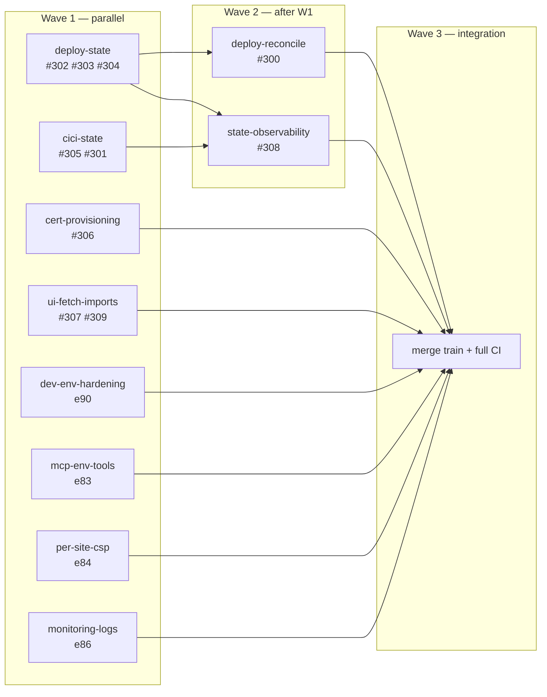

# Execution Plan — Audit 2026-11 Waves (release 3.1.0)

Status: completed
Integration branch: `integration/3.1.0` (from `audit/hotpaths-state-machines`)
Base commit: `dd9787283`
Source audit: `specs/audit/2026-11-hotpaths-state-machines.md`
Issues: #300–#309 (all closed)

## 1. Objective

Close every gap found in the 2026-11 audit and the open GitHub issues, then the
open/in-progress epics that touch the same subsystems, using parallel worktrees
with one owner per file boundary and a single integration train.

Definition of done for the program:

1. All 10 issues (#300–#309) closed by merged commits with tests.
2. `go test ./...`, `go test -race ./components/deploy/ ./components/cici/`,
   `vitest run`, `tsc`, `eslint`, `go vet` green on `integration/3.1.0`.
3. `bash scripts/validate-specs-yaml.sh` and `bash scripts/trace-stories.sh --strict` green.
4. One PR `integration/3.1.0` → `main` (or ordered PRs per wave) with CI green.

## 2. Scope and inventory

### Issues (primary)

| Issue | Priority | Workstream |
|---|---|---|
| #302 | P0 | deploy-state |
| #303 | P1 | deploy-state |
| #304 | P1 | deploy-state |
| #305 | P1 | cici-state |
| #301 | P0 | cici-state |
| #306 | P1 | cert-provisioning |
| #307 | P2 | ui-fetch-imports |
| #309 | P2 | ui-fetch-imports |
| #300 | P0 | deploy-reconcile (wave 2) |
| #308 | P2 | state-observability (wave 2) |

### Open/in-progress epics (secondary)

| Epic | Status | Workstream |
|---|---|---|
| e46 Custom Domains & Auto SSL | in_progress | cert-provisioning (#306) |
| e90 Dev-Environment Hardening | open | dev-env-hardening |
| e83 MCP site env vars | open | mcp-env-tools |
| e84 Per-site CSP | open | per-site-csp |
| e86 Monitoring logs | open | monitoring-logs |
| e81 Multi-language deploy | open | multi-lang-deploy (wave 3; e81s00 needs VPS) |

### Out of scope (do not execute)

- e57–e66: `superseded` (archived). Do not resurrect.
- e68, e70, e73, e74, e89: `planned` future release work, not audit gaps.
- Bug registry: **0 open bugs** (130 fixed, 10 wontfix, 1 done, 1 resolved).

## 3. Dependency DAG

Rules:

- `deploy-state` owns `components/deploy/state_*.go`, `gateway.go`,
  `rollback.go`, `components/sites/sites.go`, and their tests. No other
  workstream may touch those files until it merges.
- `cici-state` owns `components/cici/*`.
- `cert-provisioning` owns `components/sites/domains.go` (+ proxy only if the
  retry path needs it). Coordinate with `deploy-state` on `sites.go`; do not
  edit `sites.go`.
- `ui-fetch-imports` owns `ui/src/lib/sitesData.ts`, `ui/src/pages/SiteDetailPage.*`,
  `ui/src/components/SiteEnvVarsTab.*`, `ui/src/lib/secretsData.*`.
- Epic workstreams own their component dirs; they must not touch deploy/cici
  state files.

## 4. Worktree map (Orca)

| Workstream | Branch | Path | Linked |
|---|---|---|---|
| deploy-state | `fix/deploy-state-machine` | `/Users/danielvm/orca/workspaces/bigbase/deploy-state` | #302 |
| cici-state | `fix/cici-state-machine` | `/Users/danielvm/orca/workspaces/bigbase/cici-state` | #305 |
| cert-provisioning | `fix/cert-provisioning` | `/Users/danielvm/orca/workspaces/bigbase/cert-provisioning` | #306 |
| ui-fetch-imports | `fix/ui-fetch-imports` | `/Users/danielvm/orca/workspaces/bigbase/ui-fetch-imports` | #307 |
| dev-env-hardening | `chore/e90-dev-env` | `/Users/danielvm/orca/workspaces/bigbase/dev-env-hardening` | e90 |
| mcp-env-tools | `feat/e83-mcp-env-vars` | `/Users/danielvm/orca/workspaces/bigbase/mcp-env-tools` | e83 |
| per-site-csp | `feat/e84-per-site-csp` | `/Users/danielvm/orca/workspaces/bigbase/per-site-csp` | e84 |
| monitoring-logs | `feat/e86-monitoring-logs` | `/Users/danielvm/orca/workspaces/bigbase/monitoring-logs` | e86 |
| deploy-reconcile | `fix/deploy-reconcile` | `/Users/danielvm/orca/workspaces/bigbase/deploy-reconcile` | #300 |
| state-observability | `feat/state-observability` | `/Users/danielvm/orca/workspaces/bigbase/state-observability` | #308 |

All are based on `integration/3.1.0`; setup hooks skipped. UI worktrees must
symlink `ui/node_modules` from the main checkout before running vitest.

## 5. Concurrency protocol

1. **Max 4 implementation agents at once** (file-boundary independence + review
   bandwidth). Epics run only when an issue slot frees up.
2. Every workstream follows `develop-tdd`: RED test → minimal GREEN → refactor,
   with a `verify:` command per step.
3. Agents do **not** commit. The coordinator reviews the diff, runs the full
   package tests, then commits with Conventional Commits.
4. Merge order into `integration/3.1.0`:
   `deploy-state` → `cici-state` → `cert-provisioning` → `ui-fetch-imports` →
   `deploy-reconcile` → `state-observability` → epics.
5. After each merge: run the package suite + `go build ./...`; after the last
   merge: full preflight (`npm run compliance`,
   `bash scripts/run-verification-gates.sh`, `sync-skills`, `trace-stories`).
6. On conflict: rebase the workstream on `integration/3.1.0`; never force-push.

## 6. Per-workstream acceptance

### deploy-state (#302 #303 #304)
- CAS/atomic transition; no two terminal outcomes under `-race -count=20`.
- No persisted status outside `DeploymentState`; `replaced` resolved.
- `IsActive`/`IsTerminal`/`CanDelete` exported and consumed; rollback excludes
  `deploying`/`draining`.
- verify: `go test -race ./components/deploy/ ./components/sites/ -count=1`

### cici-state (#305 #301)
- `queued → running → success|failure|cancelled`, persisted `deadline_at`,
  invalid transitions rejected.
- Boot reconciliation finishes stale `running` rows as `failure`.
- verify: `go test ./components/cici/ -count=1`

### cert-provisioning (#306)
- `provisioning` ages out to `failed` with a reason; retry resets attempts.
- verify: `go test ./components/sites/ -count=1`

### ui-fetch-imports (#307 #309)
- one `getSite` per `SiteDetailPage.load`; imports bounded (server bulk or
  concurrency cap) with per-key errors preserved.
- verify: `cd ui && npx vitest run src/pages/SiteDetailPage.test.tsx src/lib/secretsData.test.ts src/components/SiteEnvVarsTab.test.tsx`

### Epics
Each epic closes only when its stories are `done` with verify evidence, and the
full package + UI suite stays green. e81s00 (VPS runtimes) is gated on SSH and
`harden-vps`; run it last.

## 7. Risk register

| Risk | Mitigation |
|---|---|
| Subagents edit stale checkout | Prompt pins absolute worktree path; coordinator checks `git -C <path> status` before review |
| UI worktree lacks node_modules | Symlink main `ui/node_modules` before tests |
| Deploy/cici semantic overlap | File-boundary rules; deploy-state merges first |
| Merge train drift | Rebase each workstream on integration before merge; CI per merge |
| e81 VPS work touches prod | Run through `harden-vps`, 8-gate verification, off-peak |
| Context rot | One plan file + todo list; per-workstream handoff summaries |

## 8. Execution log

| Time | Event |
|---|---|
| Wave 0 | Audit fixes committed (`ec74645de`, `4e2c08f38`, `dd9787283`); `integration/3.1.0` created |
| Wave 0 | 10 Orca worktrees created from `integration/3.1.0` |
| Wave 1 | Workstreams merged: `deploy-state` (`834cdfd54`), `cici-state` (`945f3156f`), `cert-provisioning` (`5b8ed5a8e`), `ui-fetch-imports` (`2814d8ea5`), `mcp-env-tools` (`37aede3a6`), `dev-env-hardening` (`8c6ed55e5`) |
| Wave 2 | Workstreams merged: `deploy-reconcile` (`ea4da03fc`), `state-observability` (`87a57c1c9`) |
| Wave 3 | `multi-lang-deploy` (e81s01–s06) implemented with tests and merged (`9f57588af`); e81s00 (VPS runtimes) deferred to harden-vps session |
| Close | GitHub issues #300–#309 closed with commit references; e46, e83, e84, e86 marked done; e81 and e90 statuses reconciled |
